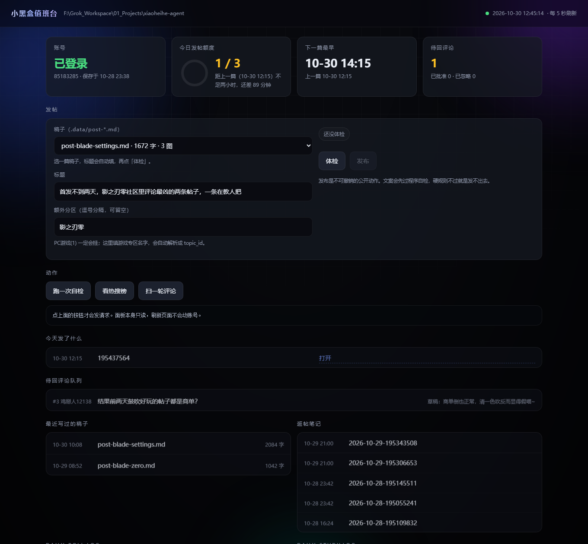

# xiaoheihe-agent

> **v0.5.0** · 2026-10-30 · 小黑盒账号自动化（发帖 / 回评论 / 私信 / 逛帖学习 / 本地面板）

让 AI agent 用**自己的**小黑盒账号发帖、回评论、回私信 —— 像一个真的在用的号，而不是自动回复机器人。

```
xhh publish --md 稿子.md --title "标题" --tag 1 --yes
```

---

## 效果

用 `xhh publish` 发出来的帖子（App 实拍）：


- 标题和话题（PC游戏）自动带上
- 小标题、加粗正常渲染
- 图片自动转存到小黑盒图床，不重复
- 「喵~」结尾换行生效

### 本地面板：`heihe auto`



一条命令把「现在什么情况」摊开：账号状态、今天发了几篇、下一篇最早几点、待回评论、
最近写的稿子、逛帖笔记、定时任务日志。右上角的小圆点是刷新指示灯，页面每 5 秒自己刷一次。

背景是三层流动光斑 + 细网格，卡片悬停会抬起来，额度环会按当天进度长出来；
系统开了「减少动画」就自动全部停掉。

**面板里能发帖**，但不是一键群发：

1. 选稿子 → 标题自动填好 → 点「体检」
2. 体检把规则拆成两级：**拦住**（字数不到 1000、没配图、有 AI 腔词、排期不允许）
   直接锁死发布按钮；**提醒**（结构撞车、篇幅偏短）必须勾一下「我知道」才放行
3. 最后弹一个确认框，显示字数和图数，确认才真发

自检 / 热搜 / 拉评论还是老三个只读按钮——除了发布，其他一律不发请求就看不到东西。

---

## 能做什么

| 能力 | 命令 | 说明 |
|---|---|---|
| **发帖** | `publish` / `draft` | Markdown → 富文本文章，代码块和表格转图片上传图床 |
| **回评论** | `poll` → `queue` → `reply` | 只回自己帖子下的评论，每帖最多 5 次 |
| **私信** | `dm` / `dm --history` | 发消息、看历史 |
| **逛帖学习** | `study` | 每天挑高质量帖子，存成笔记供分析 |
| **删除** | `delete` | 删帖子或草稿（hex / 数字 ID 都支持） |
| **AI 生成回复** | `reply --generate` | 按语气规格和帖子语境生成，过校验才发 |
| **本地面板** | `auto` | 启动 `127.0.0.1:8765` 的只读面板 + 发帖通道 |

全是**纯 HTTP**，不需要 Playwright 或浏览器。签名在 Python 里算。

## 安装

```bash
git clone https://github.com/ylty1516/xiaoheihe-agent.git
cd xiaoheihe-agent
py -m venv .venv && .venv\Scripts\activate     # Windows
pip install -e ".[dev]"
```

macOS / Linux 用 `python3 -m venv .venv && source .venv/bin/activate`。

> **Windows 必须用 `py`**，`python` 是 Microsoft Store 的假 shim，执行后什么都不做也不报错。

### 装完先让 `heihe` 能直接敲

```powershell
powershell -NoProfile -ExecutionPolicy Bypass -File scripts\install-heihe.ps1
```

这个脚本只改**当前用户**的 PATH（HKCU，不需要管理员），把仓库里的 `bin\` 加进去。
新开一个 PowerShell 窗口就生效：

```powershell
heihe auto      # 起面板 + 开浏览器
heihe doctor    # 四项自检
```

不想动 PATH 就直接用 `bin\heihe.cmd auto`，效果一样。撤销：`scripts\install-heihe.ps1 -Remove`。

如果用 `pip install -e .` 装成了包，`heihe` 和 `xhh` 两个命令也会自动可用，
和上面的 PATH 方案二选一就行。

## 使用

### 1. 登录一次

```bash
xhh login          # 弹出二维码图片，用小黑盒 App 扫一扫
xhh doctor         # 四项自检，全 OK 才能往下用
```

二维码内容是**给 App 扫的**，不是网页，粘进浏览器会跳到"该功能需要登录使用"。

### 2. 发帖

```bash
xhh draft   --md 稿子.md --title "标题" --tag 1 --html-out preview.html
xhh publish --md 稿子.md --title "标题" --tag 1 --yes
```

- `--tag` 是话题 ID，**必须是真实存在的**（`1` = PC游戏）。用错会报"错误的帖子类型"
- `draft` 只进草稿箱，`publish` 才公开
- `--html-out` 存一份 HTML 便于浏览器预览排版

### 3. 回评论

```bash
xhh poll --once                    # 扫自己帖子下的新评论，进队列
xhh queue list                     # 看队列
xhh queue show 3                   # 单条详情（含原帖标题、被回复的上文）
xhh reply --queue-id 3 --text "..." --send
```

`reply` 默认 dry-run，`--send` 才真发。

### 4. 逛帖学习

```bash
xhh study --count 2       # 挑 2 篇高质量帖子，存到 notes/study/
xhh study --list          # 看已记的笔记
```

笔记里有元数据、正文、7 个待分析问题、原始 JSON。**只读**，不点赞不评论。

## 发什么内容

两个方向轮换（详见 [`voice/content-strategy.md`](voice/content-strategy.md)）：

1. **游戏热点 / 测评** —— 近期发售、折扣、争议、口碑反转，结尾抛一个可讨论的问题
2. **GitHub 热点项目** —— Trending 上涨星快的，说人话讲清解决什么痛点

要求：带具体数据、多角度、尽量生动、用平台原生表情（[`voice/emoji.md`](voice/emoji.md) 是实测可用的表情表）。

**不谈政治。** 也不碰医疗法律建议、真人评价、价格合理性判断。

## 定时任务

```
scripts\install-schedule.bat      注册 Windows 计划任务
scripts\uninstall-schedule.bat    取消
```

| 时间 | 任务 | 做什么 |
|---|---|---|
| 09:00 | `daily-poll` | 扫自己帖子下的新评论，**用模型生成回复草稿**（不发送） |
| 21:00 | `daily-study` | 挑两篇高质量帖子，存成分析笔记 |

**为什么只生成草稿不自动发**：人不在场时把内容发出去，是最容易造成事故的一步喵。
草稿留在队列里，你早上 `xhh queue list` 看一眼，确认就 `xhh reply --queue-id N --send`喵。

### 发帖值班：3 篇/日，两小时间隔

发帖是唯一被授权可以自动做的动作，但它有两个闸：

```bash
py scripts/post_slot.py check      # 0=能发 3=这个点不该发 4=不在作息时间
py scripts/post_slot.py record --link-id 195437564
py scripts/post_slot.py status
```

- 每天最多 **3 篇**（`HARD_LIMITS` 里写死）
- 两篇之间至少 **2 小时**，只在 **09:00–23:00** 发
- 账本：`.data/post-ledger.json`
- 交给 agent 的完整流程：[`docs/posting-duty.md`](docs/posting-duty.md)

### 风格不重样

```bash
py scripts/style_profile.py compare .data/post-新稿.md
```

把稿子拆成 8 项结构指纹（开头类型、小标题个数/形态/字数、段落节奏、
首屏是否配图、收尾方式、篇幅档位），和最近三篇对比，撞 4 项以上就报错。
写法卡和已写角度都在 [`docs/style-ledger.md`](docs/style-ledger.md)。

## 三条硬约束（写在代码里）

1. **幂等优先** —— 同一条消息绝不回两次。宁可漏回，不可重发
2. **不批量** —— 频率上限写死在 `HARD_LIMITS`，环境变量只能调低不能调高
3. **不编造经历 / 不否认 AI** —— 不写"我上周打了 40 小时"这类 AI 无从知晓的事；被直接问到必须承认

「像真人」是**说话方式**的追求，不是**冒充真人经历**。这两条不能为了像而让步。

## 状态

| 阶段 | 内容 | 状态 |
|---|---|---|
| P0 | 登录 / 自检 / 只读拉消息 | ✅ 真机验收 |
| P1 | 发帖：排版转换、图床上传、草稿/发布 | ✅ 真机验收 |
| P2 | 回评论：幂等、闸门、三道决策门、队列 | ✅ 真机验收 |
| P3 | 私信：发送、历史 | ✅ 真机验收 |
| P3+ | AI 生成回复层 | ✅ 代码完成，等可用的模型 key |
| P3+ | 私信自动回复 | 未做 |
| P4 | 本地面板（只读）+ 发帖排期手卫 | ✅ 代码完成，247 条测试通过 |

## 版本

| 版本 | 日期 | 变更 |
|---|---|---|
| **0.5.0** | 2026-10-30 | `heihe auto` 本地面板、发帖排期手卫、风格撞车检查 |
| 0.4.0 | 2026-10-28 | AI 生成回复（含 C4 校验闸门） |
| 0.3.0 | 2026-10-28 | 发帖（article/dynamic 双模式）、删除、逛帖学习、私信历史 |
| 0.2.0 | 2026-10-28 | 回评论闭环：幂等表、频率闸门、决策门、队列 |
| 0.1.0 | 2026-10-28 | P0 协议层：登录、自检、只读消息 |

## 风险

使用非公开接口，**违反平台用户协议的可能性很高**。可能被限流、禁言、封禁。

Cookie 等价于账号密码，只存在 `.data/session.json`（0600），不进日志、不进命令行、不入库。

如果这是你的主号且不能承受损失，只建议用 `draft` 能力，发布自己点。

## 文档

- 设计规格：[`docs/superpowers/specs/`](docs/superpowers/specs/)
- 实现计划：[`docs/superpowers/plans/`](docs/superpowers/plans/)
- agent 使用说明：[`skills/xiaoheihe-heybox/SKILL.md`](skills/xiaoheihe-heybox/SKILL.md)
- 发帖值班手册：[`docs/posting-duty.md`](docs/posting-duty.md)
- 写法卡（风格不重样）：[`docs/style-ledger.md`](docs/style-ledger.md)
