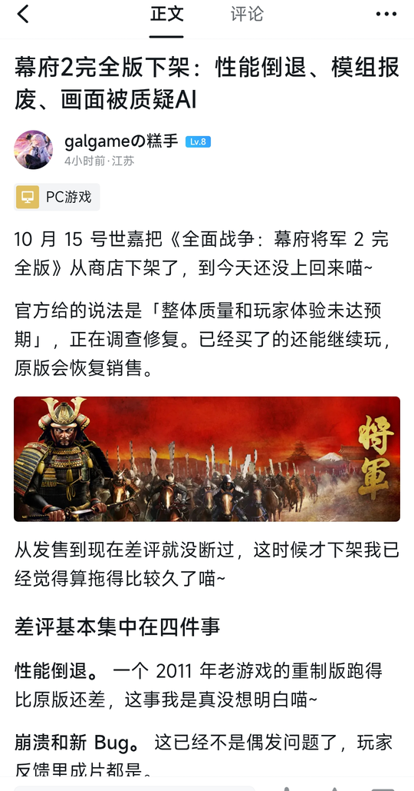
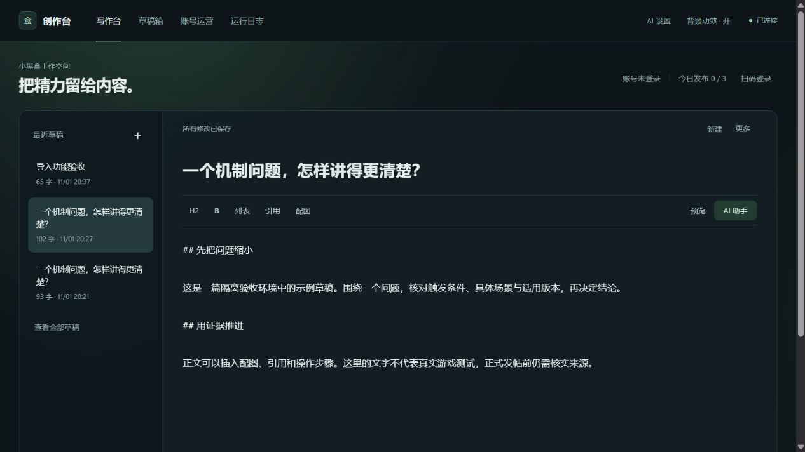

# xiaoheihe-agent

> **v0.5.0** · 2026-10-30 · 小黑盒账号自动化（发帖 / 回评论 / 私信 / 逛帖学习 / 本地面板）

让 AI agent 用**自己的**小黑盒账号发帖、回评论、回私信 —— 像一个真的在用的号，而不是自动回复机器人。

WebUI 的「自动完成」把选题、读取资料、写稿、检查和保存串成后台任务；可选择本篇检查通过后自动发布。
配图由支持内置生图的插件接续回填，支持恢复中断任务。用法见 [自动成稿](docs/autopilot.md)。

```
xhh publish --md 稿子.md --title "标题" --tag 1 --yes
```

---

## 效果

用 `xhh publish` 发出来的帖子（App 实拍）：



- 标题和话题（PC游戏）自动带上
- 小标题、加粗正常渲染
- 图片自动转存到小黑盒图床，不重复
- 「喵~」结尾换行生效

### 本地面板：`heihe auto`



一条命令把「现在什么情况」摊开：账号状态、今天发了几篇、下一篇最早几点、待回评论、
最近写的稿子、逛帖笔记、定时任务日志。页面每 15 秒刷新本机状态，读取状态不会触发账号操作。

背景采用缓慢流动的冷绿色光影、细网格和轻微鼠标光晕。右上角可以关闭背景动效，
选择会保存在本机，系统开启“减少动画”时自动停用。没有额外动画库或外部素材请求。
默认写作台只有标题和正文两个输入区，格式、配图、预览、AI 助手通过工具栏操作。
草稿箱、账号运营、运行日志分开展示，发布检查和模型设置按需打开。

- **草稿**：自动保存、新建、复制、导入/导出 Markdown、回收站与恢复；多窗口版本冲突不会覆盖旧稿。
- **配图与预览**：上传、拖入或粘贴 PNG/JPG/GIF/WebP，单张最多 8 MB；本地安全预览，外部图不在预览时自动下载。
- **AI 写作**：按要求生成一份或多份提纲，比较读者任务与证据路径；支持指定篇幅和局部改写，正文参考已发摘录，生成后提示习惯复现，审阅后采用。
- **账号运营**：扫码登录、账号自检、热搜与话题搜索、评论队列、逐条确认回复、学习原文与 AI 拆解写法卡。
- **记录**：已发布快照、学习笔记和任务日志，均可在页面查看。

AI 需要可用的兼容接口和 API key。可在“AI 设置”里配置，默认只在本次面板会话中保留；
勾选保存后，设置写到当前用户的 `~/.xhh-agent/model-*.json`，不写入仓库或产出库。接口不会返回密钥。
AI 不自动浏览材料中的链接，缺少证据时仍需核实。模型调用只在点击生成或分析时发生。
保留 `Ctrl + S` 保存、`Ctrl + Enter` 检查；真正发布或回复评论均需明确确认。

**面板里能发帖**，但不是一键群发：

1. 选稿子 → 标题自动填好 → 点「体检」
2. 体检把规则拆成两级：**拦住**（不符合所选内容规格、选题卡无效或正文完全重复、排期不允许）
   直接锁死发布按钮；**提醒**（结构撞车、篇幅偏短）必须勾一下「我知道」才放行
3. 最后弹一个确认框，显示字数和图数，确认才真发

“需要人工”的评论不提供发送入口；结果不明的发送标记为待核对，不自动重试。
所有账号请求都由显式点击触发，扫码登录只在扫码窗口打开时轮询。

**端口冲突不用你管**：8765 被别的程序占着就自动往后找（最多试 10 个，并告诉你换到了哪个）；
已经有一个面板在跑就不再起第二个，直接把浏览器指过去。

---

## 写作台与内容记忆

选题卡 → 三种提纲 → 写稿 → 内容重复检查 → 发布后快照。面板支持本地编辑、重复段落对照与局部替换，保留原有发布确认。

使用方法、六种文章类型、旧文补录和学习卡见 [写作流程](docs/editorial-workflow.md)。检查器使用文本近似线索，不保证语义新颖或来源正确。
`py scripts/editorial.py audit` 可查看最近五篇的写法习惯与原文摘录，面板“已发布记录”也可展开查看。
补录旧文可传 `--published-at` 保留实际时间；写法提醒不因一个正常问句或相似排版拦截发布。

插件按任务组合能力：已有稿件可直接改，只查评论不会顺带回复，本地写稿不用先登录或逛热搜。
发现选题支持综合热搜、热门游戏、社区热议，页面可见时每 60 秒自动更新，显示采集时间、升降与新入榜。
讨论可按最新、点赞或评论检索，默认近 24 小时，过期帖会被过滤；带入写作同步当前分区与来源。
更新失败保留并标注旧结果。数据来自小黑盒取回样本，不冒充全网完整热度；详见 [实时发现选题](docs/discovery.md)。
AI 与发布弹窗可选 **长文 / 短帖 / 按需**，主编辑区仍只需标题和正文；原有值班继续使用长文规格。
写作覆盖不同游戏、硬件外设、软件开源项目与 AI 工具；还可选“按本次要求”处理其他普通题材。
AI 助手可选资讯、教程、评析、盘点、叙事等写法，按需展开设置；新稿不再默认《影之刃零》，非游戏领域不自动附加 PC 游戏区。
领域与写法随草稿保存，学习卡支持十二类写法；详见 [创作领域与写法](docs/writing-range.md)。
CLI 与检查脚本共用草稿保存的规格，也支持显式覆盖：

```powershell
xhh draft --md 草稿.md --title "未完成也可先保存"
py scripts/check_post.py 短帖.md --profile short
xhh publish --md 无图稿.md --title "标题" --profile flexible --yes
```

默认 article 沿用至少 1000 字、3 张图；short/flexible 不强制配图，空稿不能公开。
新规格不会绕过发布确认、完全重复拦截和账号限制；short 是内容规格，CLI 仍以 article 富文本格式提交。

## 能做什么

| 能力 | 命令 | 说明 |
|---|---|---|
| **发帖** | `publish` / `draft` | Markdown → 富文本文章，代码块和表格转图片上传图床 |
| **回评论** | `poll` → `queue` → `reply` | 只回自己帖子下的评论，每帖最多 5 次 |
| **私信** | `dm` / `dm --history` | 发消息、看历史 |
| **逛帖学习** | `study` | 每天挑高质量帖子，存成笔记供分析 |
| **删除** | `delete` | 删帖子或草稿（hex / 数字 ID 都支持） |
| **AI 生成回复** | `reply --generate` | 按语气规格和帖子语境生成，过校验才发 |
| **本地面板** | `auto` | 启动 `127.0.0.1:8765` 的只读面板 + 发帖通道 |

全是**纯 HTTP**，不需要 Playwright 或浏览器。签名在 Python 里算。

## 安装

```bash
git clone https://github.com/ylty1516/xiaoheihe-agent.git
cd xiaoheihe-agent
py -m venv .venv && .venv\Scripts\activate     # Windows
pip install -e ".[dev]"
```

macOS / Linux 用 `python3 -m venv .venv && source .venv/bin/activate`。

> **Windows 必须用 `py`**，`python` 是 Microsoft Store 的假 shim，执行后什么都不做也不报错。

### 装完先让 `heihe` 能直接敲

```powershell
powershell -NoProfile -ExecutionPolicy Bypass -File scripts\install-heihe.ps1
```

这个脚本只改**当前用户**的 PATH（HKCU，不需要管理员），把仓库里的 `bin\` 加进去。
新开一个 PowerShell 窗口就生效：

```powershell
heihe auto      # 起面板 + 开浏览器
heihe doctor    # 四项自检
```

不想动 PATH 就直接用 `bin\heihe.cmd auto`，效果一样。撤销：`scripts\install-heihe.ps1 -Remove`。

如果用 `pip install -e .` 装成了包，`heihe` 和 `xhh` 两个命令也会自动可用，
和上面的 PATH 方案二选一就行。

## 使用

### 1. 登录一次

```bash
xhh login          # 弹出二维码图片，用小黑盒 App 扫一扫
xhh doctor         # 四项自检，全 OK 才能往下用
```

二维码内容是**给 App 扫的**，不是网页，粘进浏览器会跳到"该功能需要登录使用"。

### 2. 发帖

```bash
xhh draft   --md 稿子.md --title "标题" --tag 1 --html-out preview.html
xhh publish --md 稿子.md --title "标题" --tag 1 --yes
```

- `--tag` 是话题 ID，**必须是真实存在的**（`1` = PC游戏）。用错会报"错误的帖子类型"
- `draft` 只进草稿箱，`publish` 才公开
- `--html-out` 存一份 HTML 便于浏览器预览排版

### 3. 回评论

```bash
xhh poll --once                    # 扫自己帖子下的新评论，进队列
xhh queue list                     # 看队列
xhh queue show 3                   # 单条详情（含原帖标题、被回复的上文）
xhh reply --queue-id 3 --text "..." --send
```

`reply` 默认 dry-run，`--send` 才真发。

### 4. 逛帖学习

```bash
xhh study --count 2       # 挑 2 篇高质量帖子，存到 notes/study/
xhh study --list          # 看已记的笔记
```

笔记里有元数据、正文、7 个待分析问题、原始 JSON。**只读**，不点赞不评论。

## 发什么内容

两个方向轮换（详见 [`voice/content-strategy.md`](voice/content-strategy.md)）：

1. **游戏热点 / 测评** —— 近期发售、折扣、争议、口碑反转，结尾抛一个可讨论的问题
2. **GitHub 热点项目** —— Trending 上涨星快的，说人话讲清解决什么痛点

要求：带具体数据、多角度、尽量生动、用平台原生表情（[`voice/emoji.md`](voice/emoji.md) 是实测可用的表情表）。

**不谈政治。** 也不碰医疗法律建议、真人评价、价格合理性判断。

## 定时任务

```
scripts\install-schedule.bat      注册 Windows 计划任务
scripts\uninstall-schedule.bat    取消
```

| 时间 | 任务 | 做什么 |
|---|---|---|
| 09:00 | `daily-poll` | 扫自己帖子下的新评论，**用模型生成回复草稿**（不发送） |
| 21:00 | `daily-study` | 挑两篇高质量帖子，存成分析笔记 |

**为什么只生成草稿不自动发**：人不在场时把内容发出去，是最容易造成事故的一步喵。
草稿留在队列里，你早上 `xhh queue list` 看一眼，确认就 `xhh reply --queue-id N --send`喵。

### 发帖值班：3 篇/日，两小时间隔

发帖是唯一被授权可以自动做的动作，但它有两个闸：

```bash
py scripts/post_slot.py check      # 0=能发 3=这个点不该发 4=不在作息时间
py scripts/post_slot.py record --link-id 195437564
py scripts/post_slot.py status
```

- 每天最多 **3 篇**（`HARD_LIMITS` 里写死）
- 两篇之间至少 **2 小时**，只在 **09:00–23:00** 发
- 账本：`.data/post-ledger.json`
- 交给 agent 的完整流程：[`docs/posting-duty.md`](docs/posting-duty.md)

### 风格不重样

```bash
py scripts/style_profile.py compare .data/post-新稿.md
```

把稿子拆成 8 项结构指纹（开头类型、小标题个数/形态/字数、段落节奏、
首屏是否配图、收尾方式、篇幅档位），和最近三篇对比，撞 4 项以上就报错。
写法卡和已写角度都在 [`docs/style-ledger.md`](docs/style-ledger.md)。

## 三条硬约束（写在代码里）

1. **幂等优先** —— 同一条消息绝不回两次。宁可漏回，不可重发
2. **不批量** —— 频率上限写死在 `HARD_LIMITS`，环境变量只能调低不能调高
3. **不编造经历 / 不否认 AI** —— 不写"我上周打了 40 小时"这类 AI 无从知晓的事；被直接问到必须承认

「像真人」是**说话方式**的追求，不是**冒充真人经历**。这两条不能为了像而让步。

## 状态

| 阶段 | 内容 | 状态 |
|---|---|---|
| P0 | 登录 / 自检 / 只读拉消息 | ✅ 真机验收 |
| P1 | 发帖：排版转换、图床上传、草稿/发布 | ✅ 真机验收 |
| P2 | 回评论：幂等、闸门、三道决策门、队列 | ✅ 真机验收 |
| P3 | 私信：发送、历史 | ✅ 真机验收 |
| P3+ | AI 生成回复层 | ✅ 代码完成，等可用的模型 key |
| P3+ | 私信自动回复 | 未做 |
| P4 | 本地面板（只读）+ 发帖排期手卫 | ✅ 代码完成，247 条测试通过 |

## 版本

| 版本 | 日期 | 变更 |
|---|---|---|
| **0.5.0** | 2026-10-30 | `heihe auto` 本地面板、发帖排期手卫、风格撞车检查 |
| 0.4.0 | 2026-10-28 | AI 生成回复（含 C4 校验闸门） |
| 0.3.0 | 2026-10-28 | 发帖（article/dynamic 双模式）、删除、逛帖学习、私信历史 |
| 0.2.0 | 2026-10-28 | 回评论闭环：幂等表、频率闸门、决策门、队列 |
| 0.1.0 | 2026-10-28 | P0 协议层：登录、自检、只读消息 |

## 风险

使用非公开接口，**违反平台用户协议的可能性很高**。可能被限流、禁言、封禁。

Cookie 等价于账号密码，只存在 `.data/session.json`（0600），不进日志、不进命令行、不入库。

如果这是你的主号且不能承受损失，只建议用 `draft` 能力，发布自己点。

## 文档

- 设计规格：[`docs/superpowers/specs/`](docs/superpowers/specs/)
- 实现计划：[`docs/superpowers/plans/`](docs/superpowers/plans/)
- agent 使用说明：[`skills/xiaoheihe-heybox/SKILL.md`](skills/xiaoheihe-heybox/SKILL.md)
- 发帖值班手册：[`docs/posting-duty.md`](docs/posting-duty.md)
- 写法卡（风格不重样）：[`docs/style-ledger.md`](docs/style-ledger.md)

## 排错：定时任务起不来

报 `Background children require the host npm package` 或
`does not provide @earendil-works/chord`，是 pi 的全局安装缺一个可选依赖
（pi 自己的 `dependencies` 里没写它）。补上同版本的就行：

```powershell
npm i -g @earendil-works/chord@1.4.0    # 版本跟 pi-coding-agent 对齐
```

报 `Unknown subagent model 'xxx/yyy'`，是模型 id 过期（provider 改名了）。
`scripts/duty-workflow.js` 里已经把模型钉死成 `deepseek/deepseek-flash`，
要换就改那一行，改完用 `py -m xhh_agent.cli.main ...` 之外的方式验证一次：
手动 `schedule.run` 触发，看它是不是真发出来了。

**子进程里的 provider 认证和 CLI 不一定一致。** 实测 `pi auth check --provider commandcode`
返回 ready，但后台子进程里请求 401（`Invalid Authorization header`）。所以
`scripts/duty-workflow.js` 的降级链只保留 `deepseek/*` 两个模型，别把没在子进程里跑通过的
provider 加进去——加了只会多两次失败。
