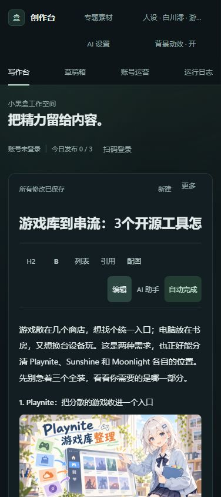
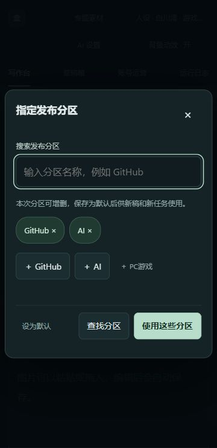
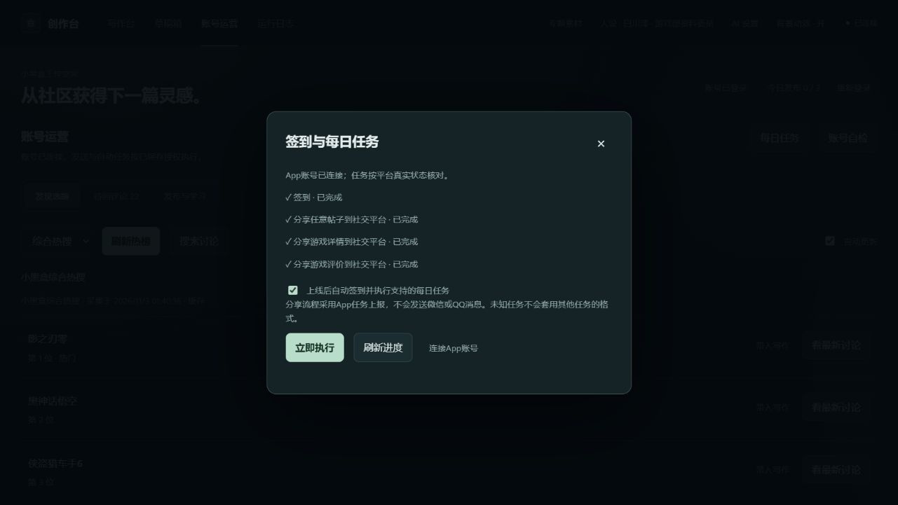

# xiaoheihe-agent

**面向小黑盒的本地创作与自动化工作台。** 从选题、资料、人设到成稿与发布，把重复操作交给工具，把判断留在内容里。

[](pyproject.toml) [](pyproject.toml) [](https://github.com/ylty1516/xiaoheihe-agent/actions/workflows/ci.yml) [](integrations/dsh-go/README.md)

[效果展示](#效果展示) · [快速安装](#安装) · [开始使用](#使用) · [手机端](#手机端) · [后台自动化](#定时任务) · [文档](#文档)

新建创作默认关注 **GitHub 开源项目、软件与 AI 工具**，发布分区默认 **GitHub＋AI**；也支持游戏、硬件和按本次要求创作。已有文章可以直接修改，无须走完固定的选题流程。

## 效果展示


**从游戏库到串流：3 个开源工具怎么分工。** 这篇示范稿已实际发布，包含分明的章节、少量 emoji、三张原创人设插画和三张真实官网截图。

[阅读小黑盒帖子](https://xiaoheihe.cn/app/bbs/link/195802469) · [查看完整正文、素材与生成过程](examples/showcase/game-tools-20261102/README.md)

截图来自隔离示例工作区的真实 WebUI，展示同一份发布稿；示范经过 agent 审校。插画是 AI 生成示意，官网截图保留来源，二者不混作实测证据。

<details>
<summary>展开手机尺寸预览与分区设置</summary>

<p>
  
  
</p>

以上为浏览器窄屏截图；DSH Go 使用独立的原生插件面板，见[手机适配说明](integrations/dsh-go/README.md)。

</details>

## 能做什么

| 创作环节 | 当前能力 |
| --- | --- |
| **发现选题** | 热搜、热门游戏和社区讨论；可见页面每 60 秒刷新，保留采集时间与过期提示，也可直接给自己的资料。 |
| **一句话成稿** | 后台读取资料、规划角度、生成正文、核对来源并保存；可暂停、继续、取消，重启保留已有进度。 |
| **统一人设** | 默认「白川澪 · 游戏部资料委员」；文章与评论共用人设规则，支持 AstrBot 导入导出、版本回滚和试写。 |
| **多样化表达** | 资讯、教程、评析、盘点、叙事等写法；学习卡、旧文摘录和结构对照辅助避开重复套路。 |
| **配图与排版** | Markdown、章节标题、少量 emoji、真实网站截图；生成图按任务冻结的人设设定接续，不同内容采用不同构图。 |
| **本地写作台** | 标题和正文两个主要输入区；自动保存、局部改写、预览、导入导出、回收站与冲突保护。 |
| **检查与发布** | 指定分区、内容规格、重复检查与发布排期；可手动确认发布，也可提前授权单篇任务自动发布。 |
| **账号与任务** | 扫码登录、评论审核队列、学习笔记；独立 App 授权后支持已适配的签到与每日任务。 |

自动写作需要配置文本模型；社区检索和公开发布需要小黑盒登录。生成插画由具备相应工具的宿主 agent 接续，**独立 WebUI 不内置聊天生图能力**。重复检查提供文本与结构线索，不保证语义新颖或事实正确。

## 安装

需要 **Python 3.11+、Git**。以下为 Windows PowerShell 命令，无需先修改系统 PATH：

```powershell
git clone https://github.com/ylty1516/xiaoheihe-agent.git
cd xiaoheihe-agent
py -m venv .venv
.\.venv\Scripts\python.exe -m pip install -e .
.\.venv\Scripts\xhh.exe auto
```

启动后会打开本机控制台，默认地址 `http://127.0.0.1:8765`。后续使用同一条 `xhh.exe auto` 命令启动；若使用下文简写的 `xhh`，请先激活虚拟环境或替换为上述完整路径。

<details>
<summary>macOS / Linux</summary>

```sh
git clone https://github.com/ylty1516/xiaoheihe-agent.git
cd xiaoheihe-agent
python3 -m venv .venv
.venv/bin/python -m pip install -e .
.venv/bin/xhh auto
```

</details>

## 使用

1. **先开始写。** 本地编辑不需要登录；在「AI 设置」配置兼容接口和模型后，可直接改现稿，或点「自动完成」输入一句要求。已有资料也可直接带入。
2. **按需要连接账号。** 「账号运营」扫码登录后，可读取社区资料和发布。「分区」可搜索、增删并保存默认值；新任务初始为 GitHub＋AI，已有任务保留自己的选择。
3. **选择完成方式。** 默认保存本地稿；需要公开发布时手动确认，或在启动单篇任务前勾选自动发布。等待配图的任务由有生图能力的助手接续。

输入要求即可开始；需要精细控制时，按需展开篇幅、写法、人设和图片设置。长文沿用至少 1000 字、3 张图的规格；短帖与按需模式不强制配图。

[自动成稿与配图](docs/autopilot.md) · [人设卡](docs/personas.md) · [发布分区](docs/publishing-topics.md) · [CLI 命令与排错](docs/cli-guide.md)

## 手机端

**WebUI 窄屏适配**：触控工具栏、弹窗、保存与分区选择随窗口宽度调整，无须在手机上操作桌面大小的表单。

**DSH Go 原生适配**：输入框胶囊启动成稿、保存随记；原生面板查看任务和分页正文、切换人设、暂停与继续，还可查看每日任务。适配器 **0.5.0**，对应后端 **0.8.0+**。

插件与后端需要安装在同一个 DSH 主机；可用手机本机引擎，也可连接在线电脑。首次 App 短信授权在后端所在主机的控制台完成。

[安装与连接步骤](integrations/dsh-go/README.md)。已通过上游 SDK 加载检查和契约测试，**尚未完成 Android 真机 APK 验收**；上面的手机截图属于 WebUI，不代表原生客户端截图。

## 定时任务

| 想自动完成什么 | 运行方式 | 需要保持运行 |
| --- | --- | --- |
| **后端常驻** | Windows 登录自启、隐藏运行、异常重试。 | 电脑开机、用户已登录；后端不会阻止系统睡眠。 |
| **每天一篇 GitHub 帖子** | 由已授权的桌面定时任务接续选题、写作、配图与发布。 | 电脑联网、后端及 Codex 桌面应用运行，可最小化。 |
| **签到与支持的每日任务** | 首次 App 授权并开启自动执行后，上线与每小时检查，已完成项跳过。 | 后端与 Node.js 24 运行，无须 Codex 常驻。 |

安装 Windows 后端常驻：

```powershell
powershell -NoProfile -File scripts/background.ps1 -Action Install
```

每日创作需在宿主另行配置和授权，**克隆仓库不会自动创建每天发帖的任务**。本机已配置的每日额度、时间和账号设置不会作为仓库默认值传播；错过时段不保证补跑。

签到使用独立的 App 登录，网页版扫码会话继续用于发帖。首次安装 App 组件需 **Node.js 24+**：

```sh
npm ci --ignore-scripts --no-audit --no-fund --prefix integrations/heybox-app
npm run build --prefix integrations/heybox-app
```

然后在「账号运营 → 每日任务 → 连接 App 账号」完成本机短信授权，再开启自动执行。

**2026-11-03 真实账号验证**：平台回读确认 App 的签到、帖子分享、游戏详情分享、游戏评价分享四项完成。分享采用 App 流程事件上报，不发送微信或 QQ 消息；网页版「评论分享」任务 11 仍未适配，不能算作完成，也不保证所有账号任务相同。

<details>
<summary>查看 App 平台回读的完成状态</summary>



</details>

[后台常驻与每日发帖](docs/background.md) · [App 授权、任务范围与恢复](docs/daily-tasks.md)

## 版本与验证

| 版本 | 本轮重点 |
| --- | --- |
| **0.8.0** | 本机 App 短信授权、签到与已适配每日任务、后台执行；DSH Go 适配器更新至 0.5.0。 |
| **0.7.0** | 默认 GitHub / AI 创作与双分区；网页和手机端搜索、选择并保存发布分区。 |
| **0.6.1** | 原创白川澪视觉设定，任务冻结人设并编译配图提示词；公开成稿示范。 |
| **0.6.0** | 统一版本化人设卡、默认人设、手机任务控制与窄屏优化。 |

代码验证覆盖 Python、App 原生签名与任务流程、DSH Go 面板与 SDK 加载；最新结果见 [GitHub Actions](https://github.com/ylty1516/xiaoheihe-agent/actions/workflows/ci.yml)。真实发布示范与 App 单账号回读验证分别列在上文，不将离线测试当作全平台实测。

## 使用边界

使用非公开接口，可能遇到接口变更、验证或账号限制。账号凭据保存在本机，网页版与 App 会话分开存放；不要提交 `.data/`、模型密钥或验证码。

公开操作遵循既有授权与频率限制。结果不明时先核对，不自动重发；缺少资料、图片工具不可用或检查未通过时保留稿件，不伪造完成。人设用于表达与视觉统一，不编造真人经历；被直接询问时不否认 AI 身份。

## 文档

| 我想了解 | 去哪里 |
| --- | --- |
| 安装、常用命令、迁移与排错 | [CLI 使用指南](docs/cli-guide.md) |
| 自动成稿与配图接续 | [自动成稿](docs/autopilot.md) |
| 人设、视觉设定与 AstrBot 交换 | [统一人设卡](docs/personas.md) |
| 分区选择与默认值 | [发布分区](docs/publishing-topics.md) |
| 旧文记忆、局部修改与学习卡 | [写作流程](docs/editorial-workflow.md) |
| 选题热榜与创作范围 | [实时发现](docs/discovery.md) · [领域与写法](docs/writing-range.md) |
| 手机原生插件 | [DSH Go 适配](integrations/dsh-go/README.md) |
| 后台运行、签到与每日任务 | [后台常驻](docs/background.md) · [App 每日任务](docs/daily-tasks.md) |
| 示范正文与图片出处 | [已发布案例](examples/showcase/game-tools-20261102/README.md) · [工具合集写法](docs/writing-style-tool-roundups.md) |
| 后续方向与当前边界 | [个人编辑部实施方案](docs/editorial-roadmap.md) |
| 接入其他 agent 与维护旧工作流 | [Agent 使用说明](skills/xiaoheihe-heybox/SKILL.md) · [发帖值班](docs/posting-duty.md) · [风格记录](docs/style-ledger.md) |

开发验证：`python -m pip install -e ".[dev]"` 后运行 `python -m pytest -q`；手机插件和 App 组件的检查命令见各自目录。设计与实现记录保存在 [规格](docs/superpowers/specs/) 和 [计划](docs/superpowers/plans/) 中。
