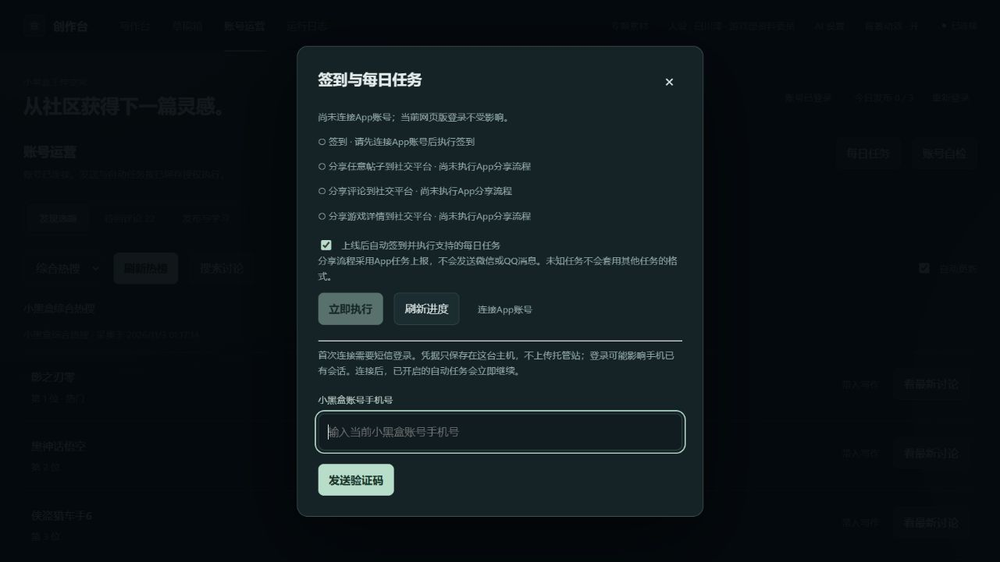

# App签到与每日任务

v0.8.0新增本机App短信授权和原生任务执行；现有网页版扫码登录继续用于创作和发布，不互相覆盖。DSH Go 0.5.0的「创作设置 → 每日任务」显示相同主机的App授权、任务进度和自动开关。

## 首次连接

电脑打开本机控制台的「账号运营 → 每日任务 → 连接App账号」，填写当前小黑盒账号手机号，请求短信后在同一页面输入验证码。每次只显示一个输入框；手机号和验证码不放进命令行、日志或Git仓库，不要发到聊天里。App登录可能影响手机已有会话。当前有网页版会话时，短信登录必须是同一个盒友账号；不一致不会替换已有App授权。

本机已按用户要求开启自动执行。首次连接成功后会立即继续支持的任务；关闭弹窗不停止后台执行。一般安装默认只检查，需在每日任务窗口开启「上线后自动签到并执行支持的每日任务」。以后后端上线时与每小时检查一次，已完成项跳过。登录失效、人机验证或限流会停止，不自动重发短信、不绕过验证。未知任务保留待处理，不误报完成。

原生任务执行不需要Codex保持打开，但需要本机后端和Node.js 24正常运行。文章写作/配图仍由已有的桌面定时任务接续。

## 安装与命令行

首次安装App组件，在项目根目录执行（Node.js至少24）：

```sh
npm ci --ignore-scripts --no-audit --no-fund --prefix integrations/heybox-app
npm run build --prefix integrations/heybox-app
xhh daily login
xhh daily run --yes
# 开启后台执行，不会在这条命令里立刻新建任务
xhh daily --auto --yes
xhh daily --refresh
```

`xhh daily login` 只在本机交互终端输入手机号/验证码；没有把验证码作为命令行参数的入口。`xhh daily --enable` 仅开启检查，不改变已保存的执行开关；`xhh daily --disable` 关闭检查与自动执行。CLI单次运行结束不会驻留；后台需保持`xhh auto`或Windows常驻服务运行。

## 分享任务的确切含义

这版使用App分享流程事件上报，不会实际发微信/QQ消息、发帖、评论、点赞或关注。选择真实存在的帖子、游戏或游戏评价，提交流程事件后回读平台任务状态，只有确认完成才登记。它模拟App分享回调，并不是验证消息真的送达社交平台；不能把它描述为真实对外分享。当前仅适配并校验任务1（帖子）、19（游戏）、31（游戏评价）及签到；名称也必须与类型匹配。

原网页版会话在2026-11-03返回的「评论分享」任务11不等于「游戏评价」任务31。App登录后会重新读取App实际清单；如果仍包含11，当前保留为未适配，而不是套用31上报或声称4/4完成。须根据后续实际App行为继续验证。已有开源实现与本机离线测试不能证明所有账号都支持全部任务。

## 凭据、恢复与状态

App凭据仅保存到当前项目`.data/app/session.json`，独立于网页版`.data/session.json`。在Windows上，首次保存前收紧专用目录ACL，仅授予当前用户和SYSTEM；其他系统使用目录0700、文件0600。验证码只在内存短暂使用，最多验证三次；发短信前记录一分钟冷却，不会因超时自动重发。关闭或重启后未完成的验证码会话需重新开始，已有成功授权保留。

原生执行记录存`.data/app-daily/<盒友ID>/YYYY-MM-DD.json`；每次写请求前持久登记意图，跨进程SQLite锁避免CLI和WebUI并发提交。中断或超时导致结果不明时，下一次先读取平台状态，未确认就停止，不盲目重报。跨日停止旧一轮；任务和签到日期按北京时间确认。

`GET /api/daily-tasks`只返回本地快照和运行状态。`POST /api/daily-tasks`支持`refresh`、`start`、`run`、`settings`；启动与开启自动执行需`confirm:true`，`start`立即返回并在后台继续，手机不会因长请求超时而重建任务。`GET/POST /api/app-session`提供本机状态及短信登录，浏览器写操作检查Origin和JSON内容类型。验证码请求通过进程私有stdin发送，不在进程参数中。

每日摘要存`.data/daily-tasks/YYYY-MM-DD.json`。平台返回不明、账号不匹配、列表为空或出现未知状态都不会判定完成。没有App授权时仍可读取网页版进度。系统不实现付费补签、抽奖、兑换或对外消息发送。

## 来源和验证范围

原生签名及登录来源固定为[heybox-daily](https://github.com/Cansiny0320/heybox-daily/tree/15d6f3c3537a2914fbef8098d5306b9a7529924c)，保留MIT许可、逐文件校验及原生签名向量；只采用经审阅的TypeScript源码，无需Java或Android二进制。编译时校验规范化LF的来源摘要。登录设备组件只执行已固定摘要的官方SDK；组件变更会停止，维护者需重新核验。

详见[原生组件说明](../integrations/heybox-app/README.md)。已完成签名向量、模拟短信/任务、Python私有通道、跨进程互斥、取消恢复、来源验证及DSH Go SDK检查。设备令牌预检已通过；未登录真实App账号前，不能声明真实签到和全部任务成功，也没有发送测试短信。

## 界面示例



[手机窄屏示例](images/app-daily-mobile.jpg)。截图未填写手机号或验证码，仅展示首次连接入口。
