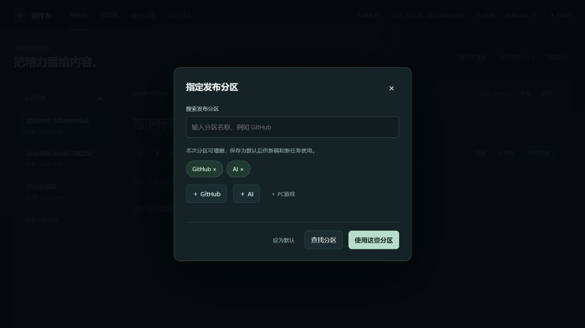

# 指定发布分区

v0.7.0 默认面向 GitHub 开源项目、软件与AI工具，新稿与新自动任务默认选择「GitHub」「AI」。2026-11-02 已通过平台搜索核对，两者实际ID分别为572430与806933；发布时仍查询并精确解析，不把AIgent等近似结果当作AI。

## 控制台

编辑区右上方点「分区」，或在发布检查中点「选择分区」。已选分区显示为标签，点叉删除；可快速添加GitHub、AI，也可搜索平台中的其他分区。搜索结果显示实际名称与ID，选中后加入列表，点「使用这些分区」保存本篇选择。至少选一个，控制台最多选五个。

「设为默认」将这份选择保存到本项目 `.data/authoring-settings.json`，供之后新建稿件和新任务使用。不会重写现有草稿与历史任务。自动成稿窗口中的「调整分区」只改变本次新任务的选择，不改动当前打开的旧稿。题材选择与发布分区分开处理。

任务创建时冻结分区，关闭页面、重启、改默认值均不会替换该任务的目标。新稿元数据保存 `topics` 列表，同时保留首项 `topic` 以兼容旧读取方；旧稿只有 `topic` 时继续保留原选择。新多分区选择不会悄悄追加PC游戏。

## 选题与命令行

DSH Go 手机原生插件0.4.0可在「创作设置 → 发布分区」选择本对话后续任务的目标；默认继承后端，设为默认与同主机网页控制台共用。新版客户端提供原生搜索框，旧版保留快捷选择。操作及更新步骤见[手机适配说明](../integrations/dsh-go/README.md)。

留空启动的新自动任务从GitHub相关讨论寻找项目话题；不是GitHub Trending统计接口。资料不足时按原流程保留待处理状态，不编造榜单与星数。明确给定的材料、题材和要求仍优先。GitHub仓库资料也可通过专题素材台的 `github:owner/repo` 读取。

```sh
xhh autopilot run --topic GitHub --topic AI --instruction "介绍一个有用的开源项目，核对原始资料"
xhh publish --md post.md --title "标题" --topic GitHub --topic AI --yes
```

自动任务省略 `--topic` 时使用当前默认值。发布命令的显式 `--tag/--topic` 优先；其次使用稿件已保存的分区，旧稿保留兼容规则；未指定方向的新本地稿采用项目默认分区。分区设置不授予自动发布权限，仍按本篇已有授权和检查执行。

已有明确题材和排期的专用任务仍按其本次要求执行；默认方向用于未明确指定的新创作。正文继续保持现有人设与写法，改变分区不要求改语言风格。

## 界面预览



[查看手机端界面](images/publishing-topics-mobile.jpg)。
