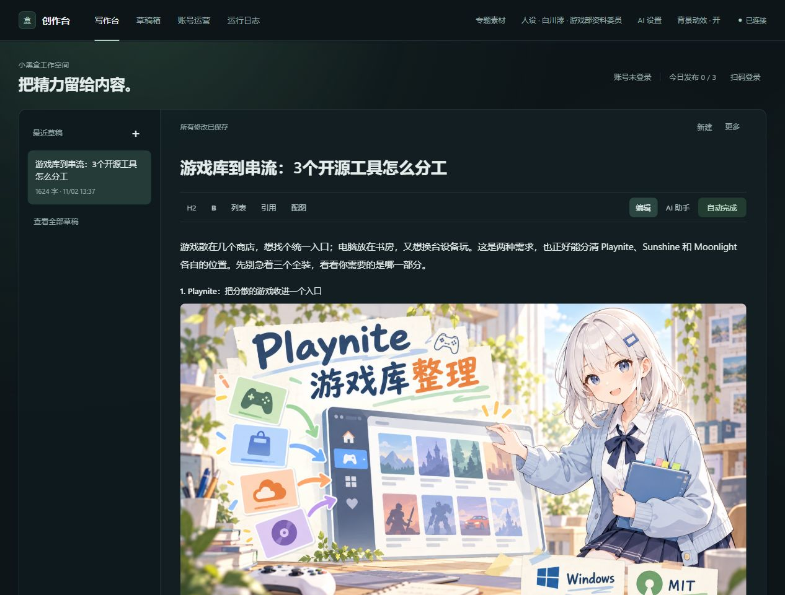
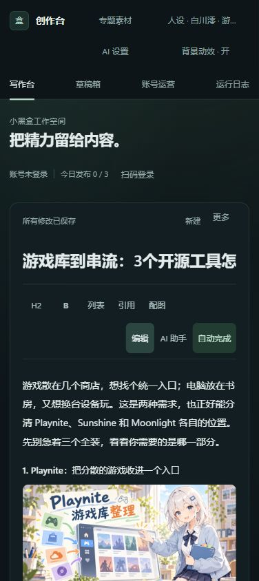

# 已发布示范：游戏库到串流

[小黑盒实际帖子：游戏库到串流：3个开源工具怎么分工](https://xiaoheihe.cn/app/bbs/link/195802469)

2026-11-02 使用 xiaoheihe-agent v0.6.1 的 `xhh autopilot` 生成，并按用户明确授权发布到账号「galgameの糕手」的 PC游戏 分区。文章以 Playnite、Sunshine、Moonlight 为例，展示项目分栏、用途说明、来源引用，以及同一人设下三种构图的原创配图。

## 工具真实成稿预览

以下截图是把同一份发布稿与三张原图放入隔离示例工作区后，由项目 WebUI 实际渲染的预览。示例工作区未复制账号凭据，因此界面显示未登录；实际发帖已通过发布回执和帖子详情核对。手机图采用浏览器手机尺寸视口，未做 Android 真机截图。

平台网页本轮触发安全验证码，因此这里展示工具预览，并链接上方真实已发布帖子，不将本地预览标成平台网页截图。





[查看完整页面截图](screenshots/webui-full.jpg) · [阅读配本地图片的完整正文](post.md)

## 生成过程

1. 阅读项目官方资料，整理当前可核对的用途、平台、许可与来源；没有使用星数、周榜、帧率或延迟来包装结论。
2. 用自动成稿工具规划并生成正文。agent 完成读者口吻与排版审校，将自然语言图片位置对齐到正文中的准确标题。
3. 以任务冻结的白川澪人设编译三张提示词，宿主内置生图后逐张回填。角色识别特征一致，布局、动作与功能图形随项目变化。
4. 共4次文本模型调用，3张原创角色概念插画。原稿有 agent 审校，不将本例描述为完全无人介入的实验。
5. 事实核对、重复与发布检查均通过，无阻断项、无提醒项。取得明确发布授权后执行一次提交，并读取帖子详情核对归属、标题与分区。

正文按官方资料整理，未进行三款工具的安装、串流或性能实测。插画不作为软件运行截图或性能证据。

## 文件

| 文件 | 用途 |
| --- | --- |
| [post.md](post.md) | 发布正文的本地图片版本 |
| [materials.txt](materials.txt) | 根据官方来源整理的写作材料 |
| [instruction.txt](instruction.txt) | 启动任务时的写作要求 |
| [persona.json](persona.json) | 本次任务冻结的完整人设卡 |
| [image-prompts.json](image-prompts.json) | 实际配图提示词、用途、锚点及人设版本 |
| [run-summary.json](run-summary.json) | 发布链接、精简检查结果与过程说明 |
| [assets](assets) | 三张实际使用的原创插画 |

## 复现本地成稿

先按项目说明配置文本模型。以下命令只生成本地稿，不公开发布；模型输出和生图结果每次可能不同。素材核对日期为2026-11-02，之后复用需更新官方资料。

```sh
xhh autopilot run --root . --subject games --genre roundup --profile flexible --images auto --material-file examples/showcase/game-tools-20261102/materials.txt --instruction "比较Playnite、Sunshine与Moonlight的分工，按当前人设写原创游戏工具合集；每个项目规划一张原创段落配图，并保留官方来源。"
xhh autopilot images --id <返回的任务ID>
# 由具备内置生图能力的宿主生成图片后：
xhh autopilot attach --id <任务ID> --image-id <配图ID> --file <图片路径>
```

独立 WebUI 不直接提供聊天里的内置生图工具。完整流程见 [自动成稿与配图](../../../docs/autopilot.md)，人设与图片规则见 [统一人设卡](../../../docs/personas.md)。
