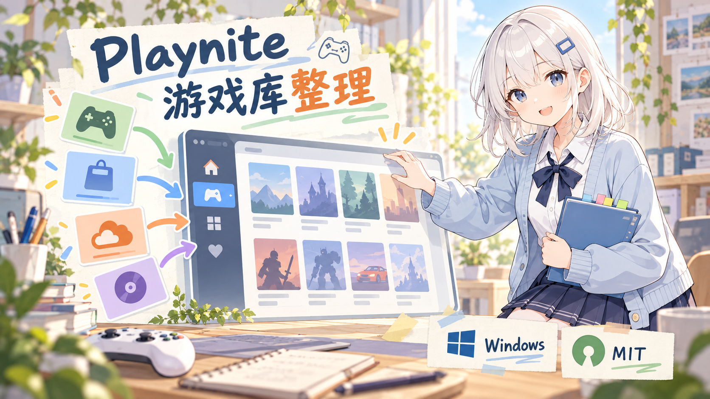
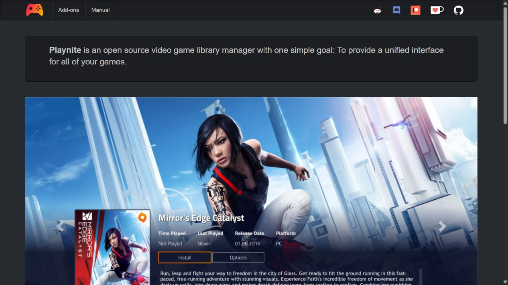
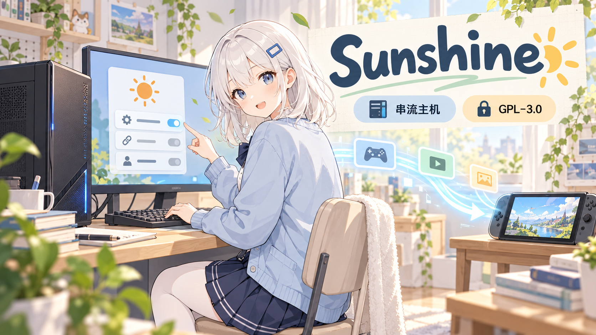
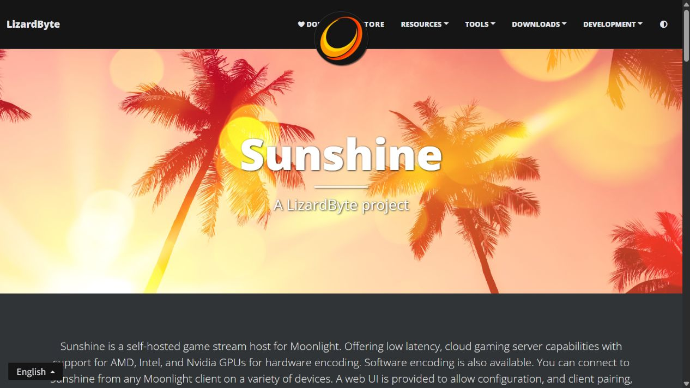
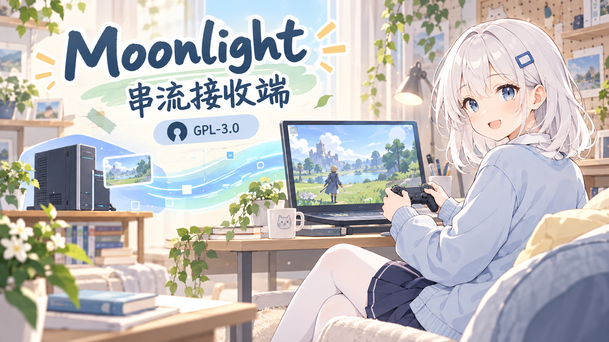
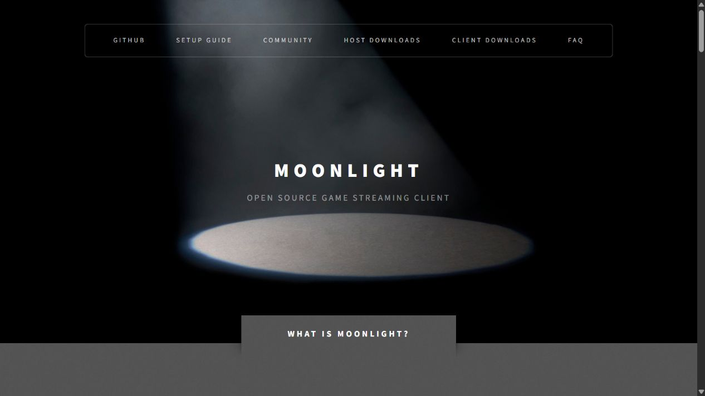

# 游戏库到串流：3个开源工具怎么分工

游戏散在几个商店，想找个统一入口；电脑放在书房，又想换台设备玩。这是两种需求，也正好能分清 Playnite、Sunshine 和 Moonlight 各自的位置。先别急着三个全装，看看你需要的是哪一部分。

---

## **🎮 01｜Playnite：把游戏库收进一个入口**

*AI生成示意图，非实测或官方画面*

资料：官方仓库 [JosefNemec/Playnite](https://github.com/JosefNemec/Playnite)｜官网 [playnite.link](https://playnite.link/)

**用途：游戏库管理与启动｜系统：Windows 10 / 11｜许可：MIT**

Playnite 把 Steam、Epic、GOG、EA App、Battle.net 等第三方游戏库接到统一界面，也支持模拟器。对于游戏分散在几个商店的玩家，它提供了一个整理、浏览和启动的入口。

*官网首页截图｜来源：[Playnite 官网](https://playnite.link/)｜2026-11-02*

- 想换展示方式：官网列出了主题和扩展支持。
- 想用手柄浏览：有完整手柄支持的全屏模式。

这里统一的是管理入口，商店账号、游戏所有权与平台本身的要求，仍需要分别处理。

如果只是想把电脑上的游戏收拾整齐，先看它就好。串流是另一件事，后面两个工具可以先放一边。

---

## **🖥️ 02｜Sunshine：运行游戏的主机侧**

*AI生成示意图，非实测或官方画面*

资料：官方仓库 [LizardByte/Sunshine](https://github.com/LizardByte/Sunshine)｜官方主页 [app.lizardbyte.dev/Sunshine](https://app.lizardbyte.dev/Sunshine/)

**用途：串流主机侧｜许可：GPL-3.0**

Sunshine 装在运行游戏的电脑这一侧，负责主机侧的编码和传输；它提供 WebUI，用来配置和配对客户端。可以先按这个方向理解：

> 运行游戏的电脑 → Sunshine → 网络 → 接收设备上的 Moonlight

官方说明支持 AMD、Intel、NVIDIA 的硬件编码，也提供软件编码。具体系统和编码组合，还是要看相应文档。

*官网首页截图｜来源：[Sunshine 官网](https://app.lizardbyte.dev/Sunshine/)｜2026-11-02*

想在另一台设备上玩电脑里的游戏，游戏仍由那台电脑运行。接收设备负责接收画面和操作，换个屏幕，并没有把运行游戏的工作搬过去。

**💡 澪的便签：**主机侧和接收端要成对考虑。先分清哪台电脑在运行游戏，配置时就少绕一圈。

---

## **📱 03｜Moonlight：接收画面和操作**

*AI生成示意图，非实测或官方画面*

资料：官方仓库 [moonlight-stream/moonlight-qt](https://github.com/moonlight-stream/moonlight-qt)｜官网 [moonlight-stream.org](https://moonlight-stream.org/)

**用途：串流接收端｜moonlight-qt 许可：GPL-3.0**

Moonlight PC 是用于 NVIDIA GameStream 和 Sunshine 的开源客户端。选它之前，先看准备拿哪台设备接收：

- Windows、macOS、Linux 或 Steam Link：查看 Moonlight PC 的对应下载。
- Android 或 iOS：查看 Moonlight 项目另外提供的移动客户端，不要把 moonlight-qt 桌面包当作手机安装包。

官网提供各平台入口，再按接收设备查对应说明，会比只搜一个项目名更清楚。

*官网首页截图｜来源：[Moonlight 官网](https://moonlight-stream.org/)｜2026-11-02*

选好接收端，再回头核对主机侧配置。设备、系统和编码路径不同，具体设置也要看对应文档。

---

## **🧭 按需求选，不必三个全装**

只想整理游戏库，先看 **Playnite**。想换一台设备玩电脑里的游戏，再看 **Sunshine 主机侧 + 对应平台的 Moonlight 接收端**。

Playnite 不是串流的必备组件，三者也不是必须一起安装的套装。需要哪一部分，就从哪一部分开始。

---

资料核对：2026-11-02，依据上方项目官方资料整理；本篇未做安装和性能实测。角色图为原创 AI 概念插画；官网截图来自各项目网站，均不作为本篇安装或性能实测证据。
